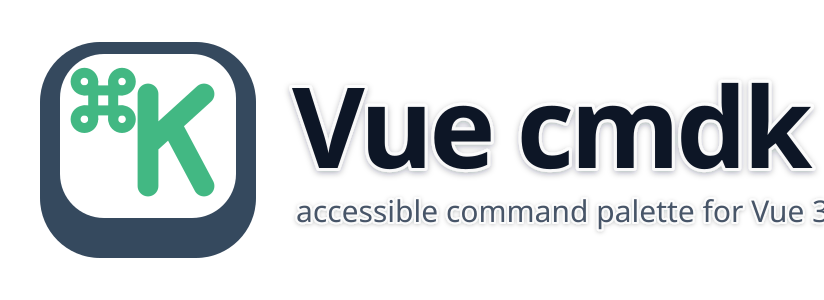
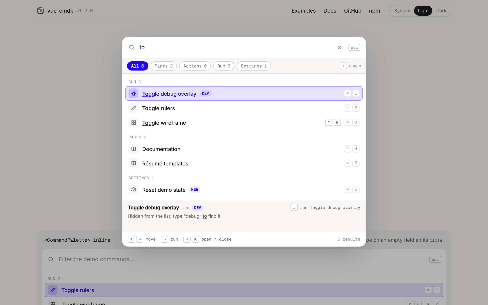
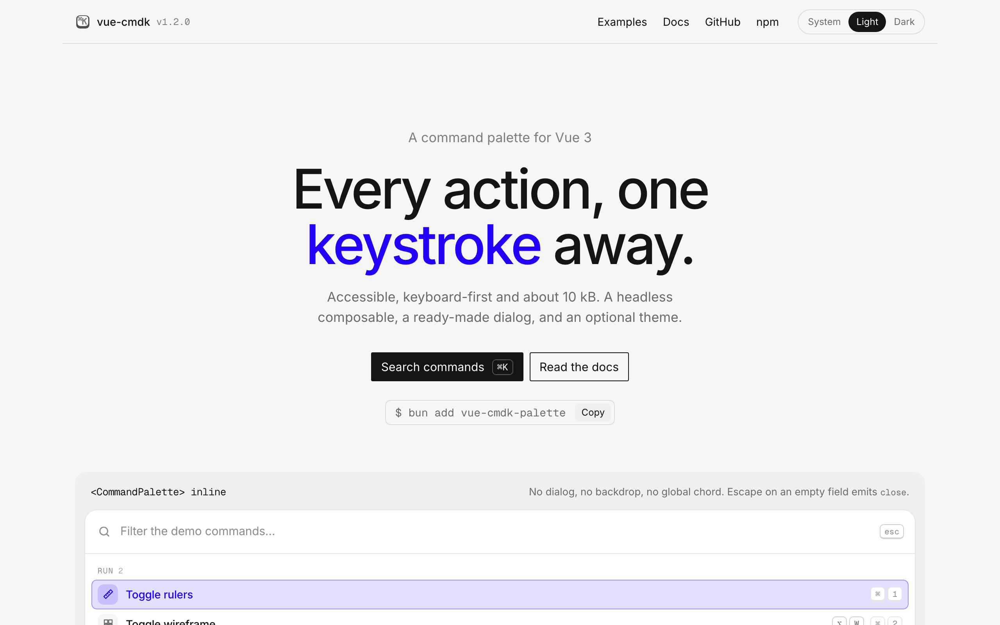
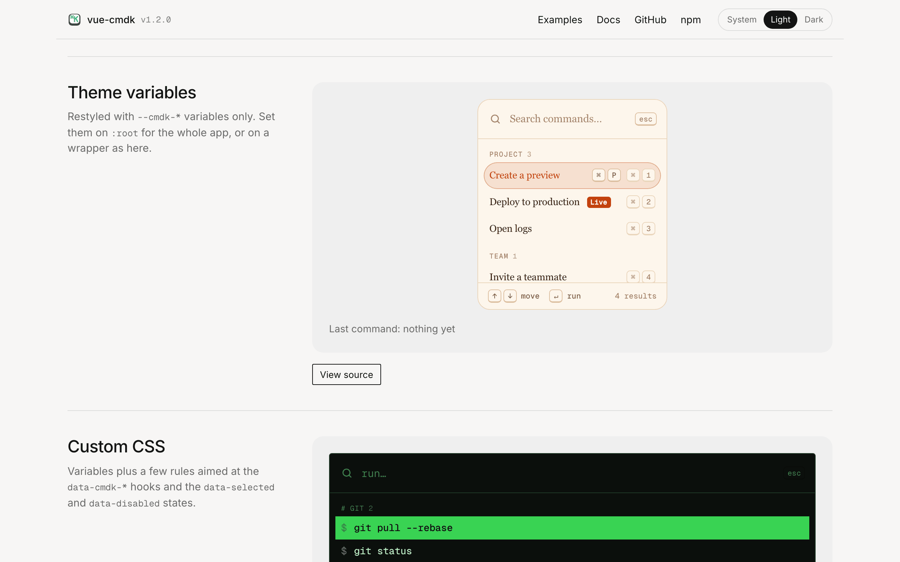

<p align="center">
  
</p>

# vue-cmdk

[](https://github.com/jantursky/vue-cmdk/actions/workflows/ci.yml)
[](https://codecov.io/gh/jantursky/vue-cmdk)
[](https://www.npmjs.com/package/vue-cmdk-palette)
[](https://bundlephobia.com/package/vue-cmdk-palette)
[](LICENSE)

[Docs](https://vue-cmdk-docs.vercel.app) · [Demo](https://vue-cmdk.vercel.app) · [npm](https://www.npmjs.com/package/vue-cmdk-palette) · [Changelog](packages/vue-cmdk/CHANGELOG.md)

A small, accessible command palette for Vue 3. This repository holds the library, a demo app and the docs site.

<a href="https://vue-cmdk.vercel.app">
  <picture>
    <source media="(prefers-color-scheme: dark)" srcset=".github/assets/palette-dark.png" />
    
  </picture>
</a>

<table>
  <tr>
    <td width="50%">
      <a href="https://vue-cmdk.vercel.app">
        <picture>
          <source media="(prefers-color-scheme: dark)" srcset=".github/assets/overview-dark.png" />
          
        </picture>
      </a>
    </td>
    <td width="50%">
      <a href="https://vue-cmdk.vercel.app/#example-theme">
        <picture>
          <source media="(prefers-color-scheme: dark)" srcset=".github/assets/themed-dark.png" />
          
        </picture>
      </a>
    </td>
  </tr>
</table>

| folder              | what it is                                                                              |
| ------------------- | --------------------------------------------------------------------------------------- |
| `packages/vue-cmdk` | The library published to npm. Its [README](packages/vue-cmdk/README.md) covers the API. |
| `apps/example`      | The demo app: every feature, plus five examples with their source.                      |
| `apps/docs`         | The docs site, built with [Blume](https://www.npmjs.com/package/blume).                 |

## Requirements

- [Bun](https://bun.sh) 1.3 or newer, for installing and running scripts.
- Node.js 22.19 or newer. Vitest's coverage and the docs build run on it, and `bun run` hands those tools to Node.

## Commands

Run these from the repository root.

```sh
bun install            # install every workspace
bun run dev            # demo app with hot reload, reading the library's source
bun run dev:docs       # docs site with hot reload
bun run build          # library, then the demo app
bun run build:docs     # library, then the docs site
bun run check          # format check, lint, typecheck, tests with coverage
bun run test:browser   # the palette in real Chromium, Firefox and WebKit
bun run lint:package   # publint and type resolution for import and require (after build)
bun run format         # format everything with Prettier
bun run lint:fix       # fix what ESLint can fix
```

`bun run build` fails if the library's main entry grows past 14 kB minified and gzipped. It also prints what an app that imports only `CommandPaletteDialog` ships, to catch growth in the common case. Coverage has minimum thresholds, so `bun run check` fails if they drop.

CI (`.github/workflows/ci.yml`) runs `check`, `build`, `lint:package` and `build:docs` on pushes to `main` and on pull requests. It uploads the coverage report to Codecov, and runs the unit tests again on Vue 3.5.0 and the latest Vue, the two ends of the peer range.

`bun run test` also renders every entry point on a server with no DOM (`test/ssr.test.ts`, with its own `vitest.ssr.config.ts` so the SSR build stays out of the coverage numbers). The browser suite runs [axe-core](https://github.com/dequelabs/axe-core) over the palette in both themes (`test/browser/a11y.test.ts`). Neither CI nor the release workflow runs it, to avoid downloading the browsers, so run `bun run test:browser` locally before a release.

The browser tests need Playwright's engines once per machine: `bunx playwright install chromium firefox webkit`.

## Releasing a new version

1. Add a new section at the top of `packages/vue-cmdk/CHANGELOG.md`, such as `## [1.1.0] - 2026-11-03`, and add its link at the bottom. If changes were collected under `## [Unreleased]`, move them into it and remove that heading, so the docs never show an empty unreleased entry.
2. Set the same version in `packages/vue-cmdk/package.json`. The demo app and the docs read it from there.
3. Run `bun run check && bun run build:docs`, then commit.
4. Tag the commit and push the tag:

   ```sh
   git tag 1.1.0
   git push origin 1.1.0
   ```

The `Release` workflow (`.github/workflows/release.yml`) takes tags with or without a `v`. It checks that the tag matches `package.json`, then runs two independent jobs: one creates the [GitHub release](https://github.com/jantursky/vue-cmdk/releases) with the changelog section as its notes, the other publishes to npm with [provenance](https://docs.npmjs.com/generating-provenance-statements), skipping a version that is already there. To create the release for an older tag, run the workflow by hand from the Actions tab with that tag. `prepublishOnly` runs the typecheck, the unit and SSR tests, the build and the package checks first, and stops the publish if any fail.

One-time setup, before the first tagged release:

- On npmjs.com, open the package's **Settings → Trusted publishing**, add GitHub Actions with repository `jantursky/vue-cmdk`, workflow `release.yml` and environment `npm`. The workflow needs no npm token after that.
- For the coverage badge, add the repository on [codecov.io](https://codecov.io) and save its upload token as the `CODECOV_TOKEN` repository secret.

Versions follow semantic versioning: a breaking change needs a new major version, listed under **Changed** in the changelog.

## Deploying to Vercel

The demo app and the docs deploy as two separate Vercel projects from the same repository. Both build the library from source first, so neither depends on a published npm version.

### Demo app

1. In Vercel, choose **Add New → Project** and import the repository.
2. Leave **Root Directory** at the repository root.
3. Leave the build settings alone. `vercel.json` at the root sets them:
   - install: `bun install --frozen-lockfile`
   - build: `bun run build`
   - output: `apps/example/dist`
4. Under **Settings → Build and Deployment**, set **Node.js Version** to 22.x.
5. Deploy.

### Docs site

1. Import the same repository again as a second project.
2. Set **Root Directory** to `apps/docs`.
3. Keep **Include source files outside of the Root Directory in the Build Step** turned on (it's the default). The build needs the library and the demo's example files.
4. Leave the build settings alone. `apps/docs/vercel.json` sets them:
   - install: `bun install --frozen-lockfile`, run from the repository root
   - build: `bun run build:docs`, run from the repository root
   - output: `dist`
5. Set **Node.js Version** to 22.x, as for the demo app.
6. Deploy. Blume picks up the production domain from Vercel's environment, so the sitemap and social cards get absolute URLs without extra config.

### From the command line

With the [Vercel CLI](https://vercel.com/docs/cli) installed and logged in:

```sh
vercel link              # once, at the repository root, for the demo project
vercel                   # preview deployment
vercel --prod            # production deployment

cd apps/docs
vercel link              # once, for the docs project
vercel --prod
```

After the first setup, every push to `main` deploys to production and every pull request gets a preview URL.

<!-- PROJECTS:START -->

## Other Projects & Products

<table>
  <tr>
    <td align="center" valign="top" width="33%">
      <a href="https://github.com/jantursky/">
        <picture>
          <source media="(prefers-color-scheme: dark)" srcset="https://apptiary.com/projects/icons/github-dark.svg">
          
        </picture>
        <br><b>GitHub Profile</b>
      </a>
      <br><sub>Open-source repositories &amp; code</sub>
    </td>
    <td align="center" valign="top" width="33%">
      <a href="https://loupekit.com/?utm_source=vue-cmdk&amp;utm_medium=readme&amp;utm_campaign=other-projects&amp;utm_content=loupekit">
        <picture>
          <source media="(prefers-color-scheme: dark)" srcset="https://apptiary.com/projects/icons/loupekit-light.svg">
          
        </picture>
        <br><b>LoupeKit</b>
      </a>
      <br><sub>Tech stack, design tokens, AI code checker</sub>
    </td>
    <td align="center" valign="top" width="33%">
      <a href="https://textarray.com/?utm_source=vue-cmdk&amp;utm_medium=readme&amp;utm_campaign=other-projects&amp;utm_content=textarray">
        <picture>
          <source media="(prefers-color-scheme: dark)" srcset="https://apptiary.com/projects/icons/textarray-light.svg">
          
        </picture>
        <br><b>TextArray</b>
      </a>
      <br><sub>Online text transformation tool</sub>
    </td>
  </tr>
  <tr>
    <td align="center" valign="top" width="33%">
      <a href="https://addonhive.com/?utm_source=vue-cmdk&amp;utm_medium=readme&amp;utm_campaign=other-projects&amp;utm_content=addonhive">
        <picture>
          <source media="(prefers-color-scheme: dark)" srcset="https://apptiary.com/projects/icons/addonhive-dark-v3.svg">
          
        </picture>
        <br><b>AddonHive</b>
      </a>
      <br><sub>Addons &amp; integrations hub</sub>
    </td>
    <td align="center" valign="top" width="33%">
      <a href="https://apptiary.com/mobile/?utm_source=vue-cmdk&amp;utm_medium=readme&amp;utm_campaign=other-projects&amp;utm_content=mobile-games-and-apps">
        <picture>
          <source media="(prefers-color-scheme: dark)" srcset="https://apptiary.com/projects/icons/stores-dark-v2.svg">
          
        </picture>
        <br><b>Mobile Games &amp; Apps</b>
      </a>
      <br><sub>Android &amp; iOS Applications</sub>
    </td>
    <td align="center" valign="top" width="33%">
      <a href="https://jantursky.com/?utm_source=vue-cmdk&amp;utm_medium=readme&amp;utm_campaign=other-projects&amp;utm_content=and-more">
        <picture>
          <source media="(prefers-color-scheme: dark)" srcset="https://apptiary.com/projects/icons/more-dark.svg">
          
        </picture>
        <br><b>And more</b>
      </a>
      <br><sub>More projects, writing &amp; contact</sub>
    </td>
  </tr>
</table>
<!-- PROJECTS:END -->

## License

MIT
